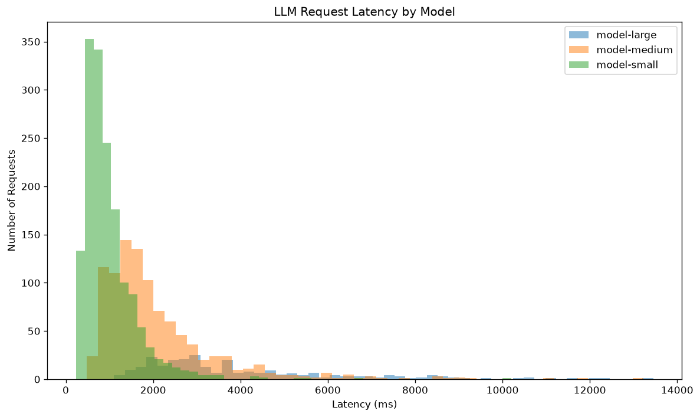
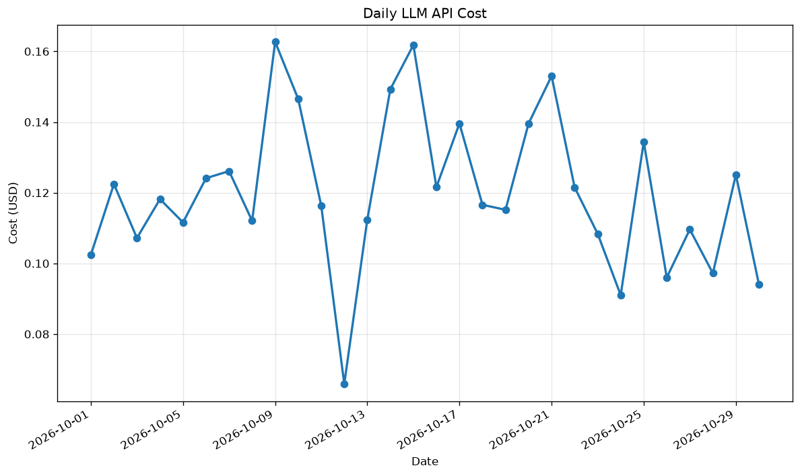

# Phase 01 — Python for AI

Goal: think in **arrays, not loops**. Every model, embedding, and dataset you touch from here on
is a numpy array or a pandas DataFrame.

| Part | File | Skill | Used later in |
|---|---|---|---|
| A | `vectors.py` | numpy, vectorization, cosine similarity, softmax | 04 deep learning, 05 transformers, 07 RAG |
| B | `analysis.py` | pandas: cleaning, groupby, percentiles, time series | 03 ML, 10 production monitoring |
| C | `report.py` | matplotlib charts | every phase README |

## Concepts

### 1. numpy arrays
A Python list holds pointers to objects scattered around memory. A numpy array is one contiguous
block of numbers of a single type (`dtype`). That's why numpy can hand the whole block to fast C code.

```python
import numpy as np

x = np.array([[1, 2, 3], [4, 5, 6]])  # shape (2, 3): 2 rows, 3 columns
x.shape, x.dtype  # (2, 3), int64
x * 10  # every element times 10, no loop
x.sum(axis=0)  # down the rows    -> [5, 7, 9]   (one per column)
x.sum(axis=1)  # across columns   -> [6, 15]     (one per row)
```
**`axis` rule of thumb:** the axis you name is the one that *disappears*.

### 2. Vectorization
Replace Python loops with whole-array operations. Same math, often 10–100x faster.
You'll measure it yourself with the benchmark in `vectors.py`.

### 3. Broadcasting
numpy stretches a smaller array to match a bigger one when shapes line up from the right:
```python
m = np.ones((4, 3))  # 4 vectors of length 3
norms = np.linalg.norm(m, axis=1, keepdims=True)  # shape (4, 1)
m / norms  # (4, 3) / (4, 1) -> each row divided by its own norm
```
`keepdims=True` keeps the shape `(4, 1)` instead of `(4,)`, so broadcasting divides **per row**.

### 4. The 3 operations behind modern AI
- **Dot product** `a @ b` measures how much two vectors point the same way. A neural-net layer is
  mostly dot products.
- **Cosine similarity** `dot(a, b) / (|a| |b|)` is the dot product with length ignored. Embedding
  models turn text into vectors, and "similar meaning" becomes "high cosine". This *is* RAG search.
- **Softmax** turns any list of scores into probabilities. An LLM outputs one score (logit) per token
  in its vocabulary, and softmax turns those into "probability of each next token".
  Numerical stability: `exp(1000)` overflows. Since `softmax(x) == softmax(x - c)` for any constant `c`,
  subtract the max first.

### 5. pandas essentials
```python
df[df["status"] == "ok"]  # boolean mask: filter rows
df.groupby("model")["latency_ms"].mean()  # split -> apply -> combine
df.set_index("timestamp").resample("D")  # time buckets (needs datetime dtype!)
df.drop_duplicates()
df.dropna(subset=["col"])
```
Two traps:
- **Mutation.** Functions that change the caller's DataFrame cause bugs that are hard to find. Return
  new objects. The tests check this.
- **Averages lie.** Latency has a long tail. Report **p50** (typical) and **p95** (bad case).
  Production AI services are judged on p95/p99.

### 6. The dataset
`datasets/llm_requests.csv`: 30 days of synthetic LLM API logs (3 fictional models), generated by
`make_dataset.py`. It has dirt on purpose (duplicates, missing latency, negative token counts), because
real logs always do. Look at it before writing any code:

```python
import pandas as pd

df = pd.read_csv("01-python-for-ai/datasets/llm_requests.csv")
df.head()
df.info()
df.describe()
```

## Exercise

Same loop as Phase 00: stubs + tests. Go in order: **A → B → C**.

```bash
uv run pytest 01-python-for-ai -k vectors     # Part A
uv run python 01-python-for-ai/vectors.py     # benchmark: note your speedup
uv run pytest 01-python-for-ai -k analysis    # Part B + C
uv run python 01-python-for-ai/analysis.py    # the report
uv run python 01-python-for-ai/report.py      # writes figures/*.png
uv run ruff check . && uv run ruff format .
```

**Git, on branch `phase-01-python-for-ai`:** commit after each part, e.g.
`feat(01): vectorized cosine similarity and softmax`. Push the branch, then open a PR into `main`
and I'll review it there.

**Stretch:**
1. `top_k_similar(query, matrix, k)` returns the indices of the k rows most similar to `query`
   (hint: `np.argsort`). You just built the core of a vector database.
2. Add `hourly_requests(df)` and find the busiest hour of the day.

## Results

<!-- Paste your benchmark speedup and the analysis.py output summary here. Embed the charts: -->
<!--    -->

## What I learned

<!-- 3–5 short bullets, one or two lines each. -->
-
